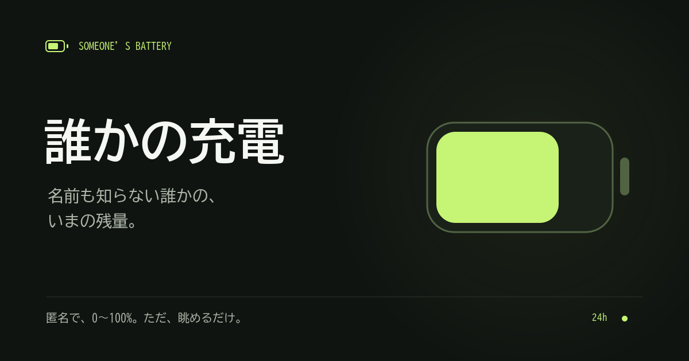
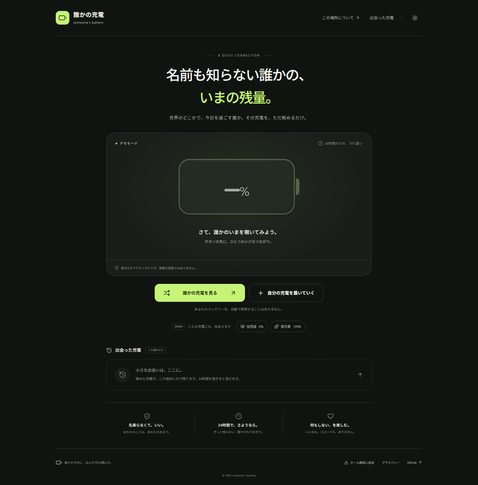
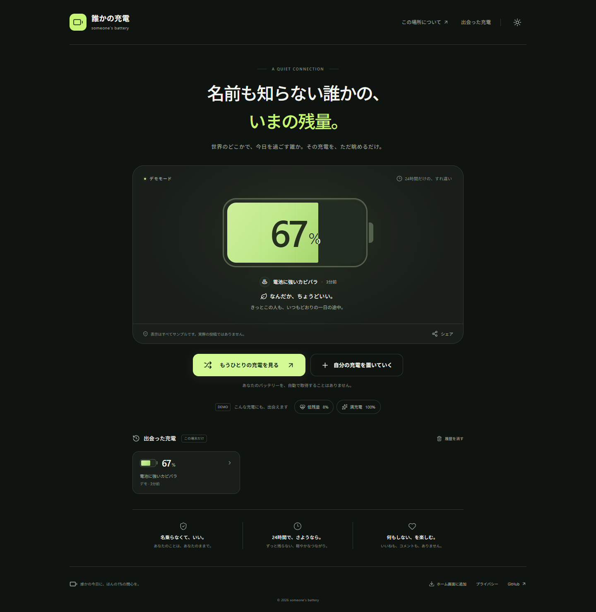
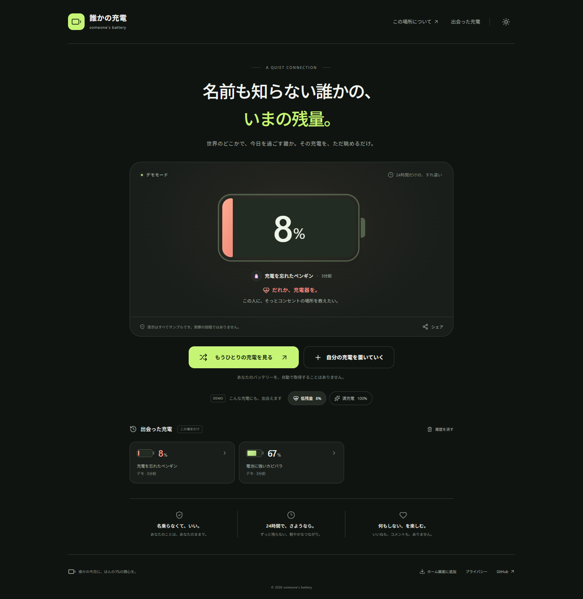
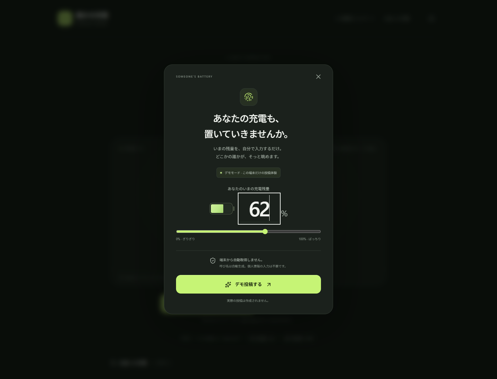
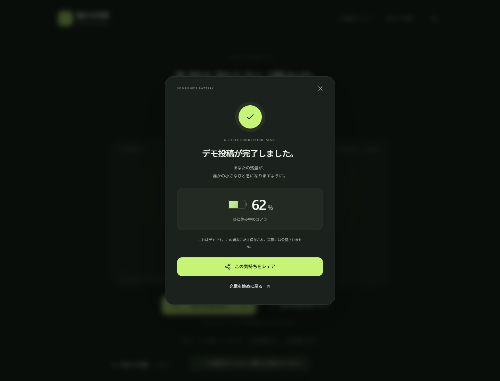

# 誰かの充電

名前も知らない誰かの、いまの残量。

世界のどこかにいる人が、自分で入力したスマートフォンの充電残量を、ただ眺める小さなWebアプリです。低残量にはそっと心配し、100%には少し大げさな拍手を。ランキングも、プロフィールも、会話もありません。



- 公開アプリ: [誰かの充電](https://someone-battery.vercel.app)
- GitHub: [shunsoco-stack/someone-battery](https://github.com/shunsoco-stack/someone-battery)
- 掲載用コピー: [docs/publish-copy.md](docs/publish-copy.md)
- 設計と制約: [docs/architecture.md](docs/architecture.md)
- セキュリティ方針: [docs/SECURITY.md](docs/SECURITY.md)
- 検証結果: [docs/verification.md](docs/verification.md)

> 公開版は「デモモード」です。Firebaseの新規プロジェクト作成上限により、実運用のFirebaseには未接続です。デモのサンプルや、このブラウザーで試した投稿は、世界のユーザーによる実投稿ではありません。Firebase接続用コード・Security Rules・TTL構成を含みますが、実運用開始には下記のセットアップが必要です。

> Vercel Analyticsの計測コードは実装済みですが、公開先はカスタムイベント非対応のHobbyプランのため、収集は停止中です。`NEXT_PUBLIC_ANALYTICS_ENABLED=false`が既定で、ブラウザーから計測リクエストを送りません。プランの変更や課金の有効化は行っていません。

## できること

- 「誰かの充電を見る」で、24時間以内の投稿からランダムに1件表示。
- 大きな電池と残量別のリアクション。「3分前」のような相対時刻。
- 0〜100の整数をスライダー／数値入力から投稿。端末の残量は自動取得しません。
- 「充電を忘れたペンギン」など、地域・属性に結びつかない呼び名を自動生成。
- 最近見た最大12件を端末内に保存。期限切れは履歴からも除外。
- 共有シート／コピーによる共有。投稿者の識別子や個人情報を含めません。
- ダーク／ライト表示、レスポンシブ、キーボード操作、動きを減らす設定に対応。
- インストール用manifest、アイコン、オフライン案内を備えたPWA。

実データが0件の場合は、必ず「まだ誰も投稿していません」と表示します。接続エラーをサンプルデータで隠すことはありません。

## デモと実データの境界

| Firebaseの公開設定 | 動作 |
| --- | --- |
| 必須4項目がすべて空 | 「デモモード」を表示。明示されたサンプルとブラウザー内の試用投稿のみ。Firebaseには接続しません。 |
| 一部だけ設定 | 設定不備を表示。デモへ切り替えません。 |
| すべて設定 | Firebase匿名認証とFirestoreを利用。実データだけを表示。 |
| 設定済みで認証・通信・権限エラー | エラーと再試行手段を表示。デモへ切り替えません。 |

履歴の保存領域も実データ用とデモ用で分離しています。URLのパラメーターで本番の実データを偽サンプルに置き換える仕組みはありません。

## プライバシー

アプリはBattery Status API、位置情報API、端末のフィンガープリントを使用しません。残量は本人による自己申告であり、正確さを検証した測定値ではありません。

Firestoreの投稿に保存するのは、次の4フィールドだけです。氏名、メールアドレス、位置、端末機種、IPアドレス、Auth UIDは投稿に保存しません。自由記述も受け付けません。

| フィールド | 型 | 内容 |
| --- | --- | --- |
| `percentage` | integer | 0〜100の自己申告残量 |
| `createdAt` | timestamp | Firestoreのサーバー時刻 |
| `expiresAt` | timestamp | 24時間後の期限。TTL対象 |
| `anonymousName` | string | 固定の語彙から生成した呼び名 |

Firebase Authenticationはサービス側で匿名アカウントとUIDを管理します。アプリの認証状態はメモリー内に保持し、投稿とは紐づけません。Firestore SDKも永続キャッシュを有効にしません。最近見た履歴とデモ投稿は、このブラウザーの`localStorage`だけに保存されます。

計測機構はVercel Analyticsへのサーバー中継として実装しています。現在の公開版では無効です。有効化した場合もブラウザー用Analyticsスクリプトは読み込まず、許可した操作名と`demo`／`live`のモードだけを送ります。中継では訪問者のIP・User-Agent・Cookieを引き継がず、固定値へ置き換えます。残量、匿名名、投稿ID、UID、入力値、URLクエリーは計測データに含めません。DNT／GPCとアプリ内の計測設定を尊重します。

これは「通信を受けるサービスが一切情報を処理しない」という保証ではありません。VercelやFirebaseの配信・認証・不正利用対策など、基盤側の通信処理は各サービスのポリシーに従います。アプリ自身が保存する投稿・履歴・計測データとは区別してください。

## ローカル起動

Node.js 22または24、npmを使用します。Next.jsの安定版と依存バージョンは`package-lock.json`で固定しています。

```sh
npm ci
npm run dev
```

`http://localhost:3000`を開きます。Firebaseを設定しない状態では、明示的なデモモードで動作します。デモの試用投稿は他のブラウザーや利用者には配信されません。

実データで動作させる場合は`.env.example`を`.env.local`へコピーし、Firebaseの公開Web設定を入力します。`.env.local`はGitへ追加しないでください。

## Firebaseの設定

### 1. プロジェクト・Webアプリ

1. 自分が管理できる専用のFirebaseプロジェクトを作成します。他アプリの既存データベースを流用しないでください。
2. Firebase ConsoleでWebアプリを登録します。Firebase用Google Analyticsは、このアプリには不要です。
3. Webアプリの設定から以下の4値を`.env.local`、およびVercelの対象環境へ設定します。

```dotenv
NEXT_PUBLIC_FIREBASE_API_KEY=
NEXT_PUBLIC_FIREBASE_AUTH_DOMAIN=
NEXT_PUBLIC_FIREBASE_PROJECT_ID=
NEXT_PUBLIC_FIREBASE_APP_ID=
```

これらはFirebaseの公開Web設定です。管理者の秘密鍵ではなく、アクセス制御の代わりにもなりません。サービスアカウントJSON、Admin SDKの秘密鍵、Firebase CLIの認証トークンを`NEXT_PUBLIC_*`へ置いたり、リポジトリへコミットしたりしないでください。

`NEXT_PUBLIC_*`はビルド時に取り込まれるため、変更後は開発サーバーを再起動するか、Vercelを再デプロイします。

### 2. 匿名認証

Authentication → Sign-in methodでAnonymousを有効にします。Authenticationの承認済みドメインに、利用する本番ドメインを登録します。ローカル開発を行う場合は`localhost`も確認してください。メールやパスワードの入力は不要です。[Firebaseの匿名認証ガイド](https://firebase.google.com/docs/auth/web/anonymous-auth)

匿名認証は「本人確認」や強力なスパム防止ではありません。SDKが一時的な利用者としてFirestoreへアクセスできるようにするものです。

### 3. FirestoreとSecurity Rules

FirestoreのStandard edition / Native modeで`(default)`データベースを作成します。リージョンは運用方針に合わせて選択してください。テストモードの公開ルールを使い続けないでください。

ローカルのFirebase CLIでログインし、明示的に対象プロジェクトを指定してデプロイします。

```sh
npx firebase login
npx firebase deploy --only firestore:rules,firestore:indexes --project YOUR_FIREBASE_PROJECT_ID
```

`firebase.json`から`firestore.rules`と`firestore.indexes.json`が読み込まれます。コレクションは`batteryPosts`です。

ルールは匿名認証による読み取り／新規作成のみを許可します。0〜100の整数、サーバー時刻、許可された匿名名、期限、4フィールド完全一致を検証し、余分なフィールド、編集、削除、他コレクションへのアクセスを拒否します。読み取りクエリーは1ページ最大200件に制限します。

`createdAt`は`serverTimestamp()`、`expiresAt`はクライアント時刻の24時間後です。期限の書き込みにはサーバー時刻に対して±5分の許容を設けています。端末時計が大きくずれていると投稿に失敗するため、日時の自動設定を有効にしてください。表示期限はこの許容にかかわらず、`createdAt + 24時間`と`expiresAt`の早い方を超えません。

### 4. TTLを有効にする

`firestore.indexes.json`には`batteryPosts.expiresAt`のTTL設定を含みます。設定のデプロイ後、Google Cloud ConsoleのFirestore → Time-to-liveで、対象ポリシーが有効になっていることを確認してください。CLIで明示的に設定する場合:

```sh
gcloud firestore fields ttls update expiresAt --collection-group=batteryPosts --enable-ttl --project=YOUR_FIREBASE_PROJECT_ID
gcloud firestore fields ttls list --collection-group=batteryPosts --project=YOUR_FIREBASE_PROJECT_ID
```

TTLによる削除には課金の有効化が必要です。費用や予算を確認し、所有者の判断で設定してください。アプリのデプロイだけで課金を有効化することはありません。[Firestore料金](https://firebase.google.com/docs/firestore/pricing)

TTLは即時削除ではなく、通常は期限後24時間以内に処理されます。そのため「24時間後に表示対象外」と「物理削除」は別です。アプリはTTL完了を待たずに期限切れを除外します。現在のルールでは、認証済みの直接クエリーで削除待ちの期限切れデータを読める可能性があります。厳密な期限後の読み取り拒否が必要な用途には、信頼できるサーバーAPIなどの追加設計が必要です。[Firestore TTLガイド](https://firebase.google.com/docs/firestore/ttl)

### 5. 実接続の確認

- 新しいブラウザーで匿名認証が成功し、空のDBで「まだ誰も投稿していません」と表示される。
- 自分の残量を投稿し、Firestoreに4フィールドだけが作成される。
- 別ブラウザーから投稿を表示できる。デモのサンプルは混ざらない。
- 0と100が投稿でき、範囲外・小数・追加フィールドはルールで拒否される。
- 認証・ネットワークを失敗させると、デモではなくエラーが表示される。
- 期限切れが表示・履歴から除外され、TTLが有効になっている。

本リポジトリを取得しただけでは、Firebaseプロジェクト作成、匿名認証、ルール適用、TTL有効化は完了しません。

## Vercelへの公開と計測

現在の公開URLは[https://someone-battery.vercel.app](https://someone-battery.vercel.app)です。デモの公開と、実Firebase／Analyticsの運用開始は別の作業です。

1. 専用のGitHubリポジトリ`someone-battery`をVercelにインポートします。
2. Framework PresetはNext.js、Root Directoryはこのリポジトリのルートにします。
3. 実データで公開する場合だけ、Firebaseの4変数をまとめて設定します。未設定で公開した場合はデモになります。
4. `NEXT_PUBLIC_SITE_URL`を本番URLへ合わせて再デプロイします。
5. 計測を開始する場合は、カスタムイベント対応のPro／Enterpriseプランであることと費用を所有者が確認し、対象プロジェクトのダッシュボードでWeb Analyticsを有効にします。Hobbyでは計測を無効のままにしてください。
6. 対応プランとダッシュボード設定を確認できた場合だけ、Vercelの環境変数`NEXT_PUBLIC_ANALYTICS_ENABLED=true`を設定して再デプロイします。未設定または`false`では、ブラウザーの送信とサーバーからVercelへの中継の両方を停止します。
7. DNT／GPCやアプリ内の計測無効化が適用されていない検証環境で、公開ページの表示、投稿、共有を操作し、AnalyticsのEventsパネルで以下を確認します。

| イベント | 発火時点 | 独自プロパティ |
| --- | --- | --- |
| `page_view` | アプリ表示 | `mode` |
| `battery_view` | 1件の残量を正常に表示 | `mode` |
| `battery_post` | 投稿が正常に完了 | `mode` |
| `battery_share` | 共有／コピーが正常に完了 | `mode` |

`mode`は`demo`または`live`です。デモでの試行を、実運用の投稿実績として集計しないでください。

これらは標準のブラウザー自動ページビューではなく、サーバー経由のカスタムイベントです。`page_view`という名前でもカスタムイベントとして扱われます。訪問者情報を固定化するため、ユニーク訪問者数、端末別・地域別の分析は意図して行いません。カスタムイベントにはVercelのPro／Enterpriseプランが必要です。Hobbyのままではイベントの収集・表示を利用できません。プラン変更は所有者が費用を確認したうえで行ってください。[Analytics利用条件](https://vercel.com/docs/analytics/limits-and-pricing)、[カスタムイベント](https://vercel.com/docs/analytics/custom-events)

`/api/analytics`のHTTP 202は、形式の正しいリクエストをアプリが受け付けたことだけを示します。計測無効時も202を返し、SDKの`track()`も収集先での成功を保証する戻り値を提供しません。Vercelへの収集完了はダッシュボードで別途確認してください。現在の公開版について、閲覧・投稿・共有の収集成功は主張していません。

デプロイ保護付きのPreviewではサーバーからのイベントが遮断される場合があります。必要ならVercelのProtection Bypass for Automationをサーバー側で設定してください。バイパス用の秘密値をフロントエンドやGitへ置かないでください。[公式の保護付き環境の説明](https://vercel.com/docs/analytics/custom-events#deployment-protection-and-server-side-events)

## 検証コマンド

```sh
npm run lint
npm run typecheck
npm test
npm run test:rules
npm run test:e2e
npm run build
npm run secret-scan
```

Firestore RulesのテストはローカルエミュレーターとJava 21以上を使用します。`demo-someone-battery`はエミュレーター用IDであり、実プロジェクトではありません。E2EにはPlaywrightのブラウザーが必要です。初回は`npx playwright install chromium`を実行してください。

検証はクライアント入力、期限、履歴の分離、ルールの拒否条件、実際の画面操作をそれぞれ確認します。エミュレーターの成功は、本番Firebaseの設定・接続成功を意味しません。

2026-08-27のローカル検証では、lint・typecheck・buildが成功し、unit tests 150件、Firestore Emulator tests 43件、E2E 19件がすべて成功しました。公開URLでも通常のE2E 19件＋PWA専用1件、合計20件が成功しています。axeの8画面状態で自動検出の違反は0件、本番依存の`npm audit --omit=dev`は脆弱性0件でした。最終Secret Scanなどの状態は[verification.md](docs/verification.md)に分けて記録します。

公開済みデモでPWAを含む20件を再検証する例（sh系シェル）:

```sh
PLAYWRIGHT_BASE_URL=https://someone-battery.vercel.app PLAYWRIGHT_TEST_PWA=1 npm run test:e2e
```

PowerShellでは同名の`$env:PLAYWRIGHT_BASE_URL`と`$env:PLAYWRIGHT_TEST_PWA`を設定してから`npm run test:e2e`を実行します。通常の開発サーバーではPWA専用テストをskipします。これらのE2Eはデモであることを確認してから操作するもので、実Firebaseの投稿テストを代替しません。

`secret-scan`は作業ツリー、Gitのステージ内容、ローカル全refから到達できる履歴を検査します。秘密鍵・トークン・認証ファイルなどの混入を検出しますが、すべての秘密情報を検出できる保証はありません。GitHub公開前に差分を確認し、GitHubのSecret scanning／Push protectionも利用してください。流出した秘密情報は削除だけで済ませず、発行元で失効・再発行します。検査範囲と限界は[SECURITY.md](docs/SECURITY.md)、実行結果は[verification.md](docs/verification.md)を参照してください。

## スクリーンショット

[公開アプリ](https://someone-battery.vercel.app)から2026-08-27に取得し、目視確認した5枚を`public/screenshots/`へ保存しています。以下のデモ表示は操作例であり、実ユーザーの投稿・利用実績を示すものではありません。OG画像はブランド用の図版で、スクリーンショットではありません。

### 1. トップ画面



### 2. 誰かの充電表示



### 3. 低残量表示



### 4. 自分の充電投稿画面



### 5. 投稿完了画面



## デザインとアセット

黒に近い`#101411`、柔らかなライム`#c6f475`、白`#f5f7f2`を中心に、電池そのものを主役にしています。大きな残量と余白で情報の優先順位をつくり、操作状態を色だけに依存せず伝えます。アニメーションは`prefers-reduced-motion`を尊重します。

`public/icon.svg`と`public/favicon.svg`はオリジナルの図形です。PNGアイコン、maskableアイコン、Apple touch icon、ICO、1200×630のOG画像を同梱しています。再生成は`npm run assets`。OGの日本語描画にはOSにインストール済みの日本語フォントを使用し、フォントファイルは配布しません。別のフォントを使う場合は`OG_FONT_FILE`と`OG_FONT_FAMILY`を設定します。アプリのビルドでは再生成不要です。

## 運用上の制約

- ランダム選択は、200件ずつ取得した有効な全投稿からreservoir samplingで行います。最初の200件だけには偏りませんが、1回表示するごとに有効投稿数に比例した読み取り料金がかかります。
- 大規模運用では、プライバシー要件を保つ信頼されたバックエンド側のサンプリングが必要です。
- UI上の連投防止や匿名認証だけでは、不正クライアントによる大量投稿を防げません。公開運用時はクォータ、予算通知、必要に応じたApp Checkなどを検討してください。追加サービスのデータ処理は別途確認が必要です。
- バッテリー残量は自己申告です。名前は架空で重複し得ます。同じ名前でも同じ人とは限りません。
- オフラインでは新しい実投稿を取得できません。送信成功はサーバーから確認できた場合だけ表示します。独自の永続的なオフライン送信キューは設けていませんが、送信中に通信が途切れた場合はFirebase SDKが接続回復を待つことがあります。
- ローカル履歴はブラウザーのサイトデータ削除やアプリ内の履歴削除で消えます。クラウドの個人プロフィールではありません。

## 技術構成

Next.js / React / TypeScript / Tailwind CSS / Firebase Authentication / Cloud Firestore / Vercel Analytics / Vitest / Firebase Emulator / Playwright / sharp。

設計上の判断や信頼境界は[architecture.md](docs/architecture.md)、ポートフォリオ・Tsukutta・YOUTRUST向けの文章は[publish-copy.md](docs/publish-copy.md)を参照してください。
